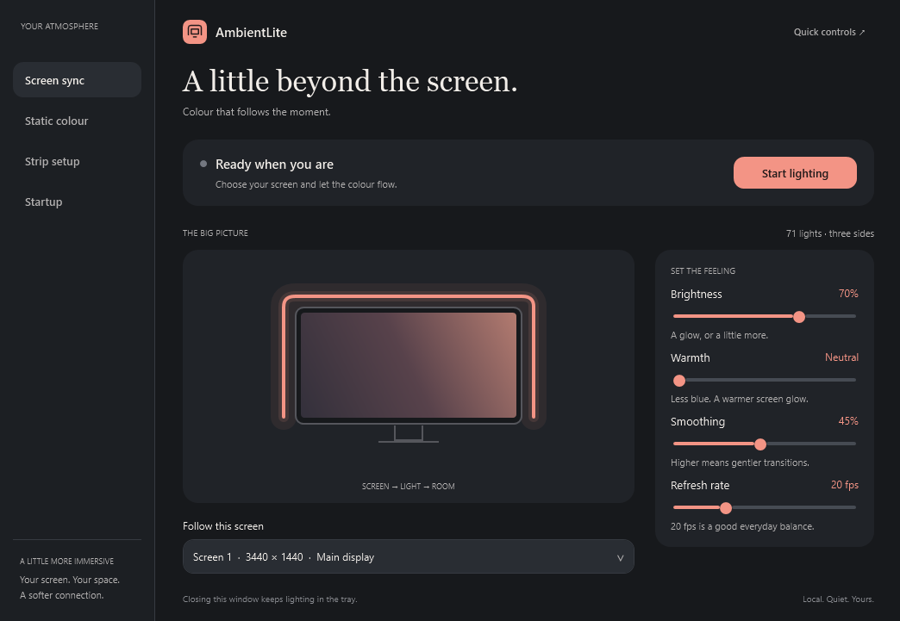
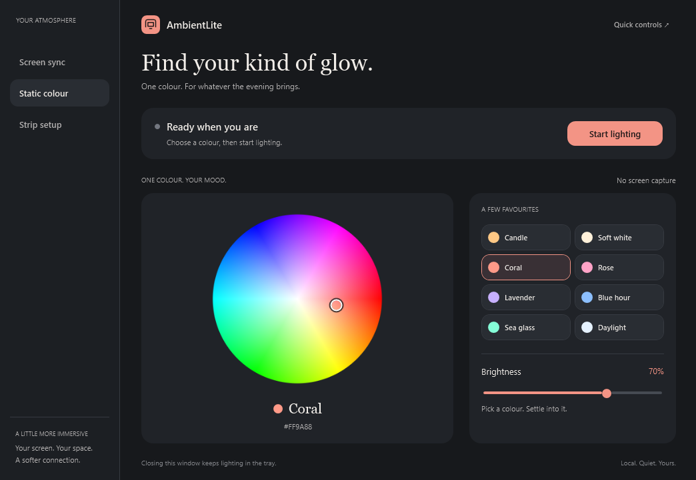
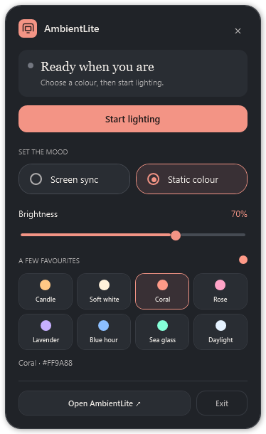
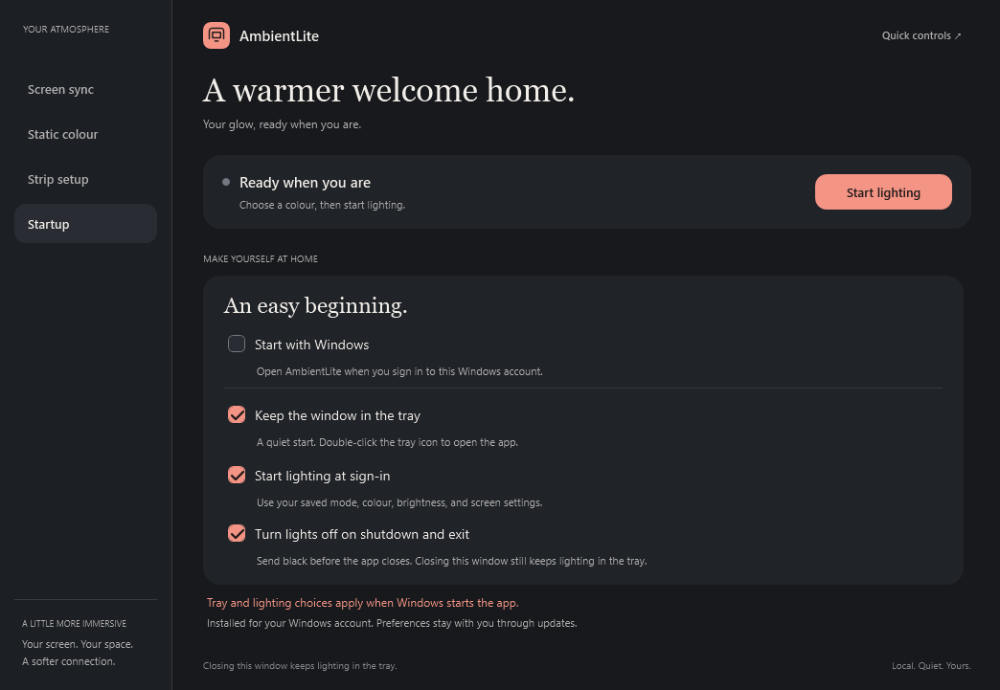

<div align="center">

# AmbientLite

**A little beyond the screen.**

Lightweight Windows ambient lighting for a Robobloq-compatible USB monitor strip.

[**Download installer**](https://github.com/AlbinoPriest/ambientlite/releases/latest/download/AmbientLiteSetup.exe) · [Portable ZIP](https://github.com/AlbinoPriest/ambientlite/releases/latest/download/AmbientLite-windows-x64.zip) · [Releases](https://github.com/AlbinoPriest/ambientlite/releases/latest) · [Report an issue](https://github.com/AlbinoPriest/ambientlite/issues)

</div>



## Download and run

**For most people: [download AmbientLiteSetup.exe](https://github.com/AlbinoPriest/ambientlite/releases/latest/download/AmbientLiteSetup.exe).** Run it, open AmbientLite from the Start menu, and exit SyncLight before starting the lights. No terminal, build tools, account, or administrator access is needed.

| Download | Best for |
|---|---|
| [Windows installer](https://github.com/AlbinoPriest/ambientlite/releases/latest/download/AmbientLiteSetup.exe) | Everyday use. Start menu shortcut, Windows uninstall support, and preferences kept through updates. |
| [Portable ZIP](https://github.com/AlbinoPriest/ambientlite/releases/latest/download/AmbientLite-windows-x64.zip) | Unzip into a writable folder and run `AmbientLite.exe`. Includes diagnostics, documentation, and licenses. |
| [App EXE only](https://github.com/AlbinoPriest/ambientlite/releases/latest/download/AmbientLite.exe) | A single-file portable app. Saves `settings.txt` next to itself. |

Requires **Windows 10/11 x64, .NET Framework 4.8, and a [compatible USB strip](#the-strip-i-use)**. Downloads are currently unsigned, so Windows may show a reputation warning. Get them from this repository's Releases page. [SHA-256 checksums](https://github.com/AlbinoPriest/ambientlite/releases/latest/download/SHA256SUMS.txt) are provided for each download.

The installer and portable downloads run the same app. Installation adds no background service or updater.

## Why this exists

I bought a USB LED strip for the back of my monitor. The hardware did exactly what I wanted: extend the colours on screen into the room. But the supplied SyncLight software felt like a lot of app for a strip of lights.

SyncLight uses Electron and runs several processes. In a short local sample, those processes used about **472 MB of memory and 2.14% CPU** on my i7-13700K. I wanted the useful part—screen colours, a steady glow, and quick adjustments—without the browser-sized interface around it.

AmbientLite is a small native Windows app that talks directly to the existing USB controller. It keeps screen syncing, a colour wheel, curated colours, and tray controls in one place. There is no account, network service, or telemetry. It uses the strip's existing firmware and Windows HID driver.

The WPF interface measured about **138 MB of working memory and 1.01% CPU** in a short screen-sync sample with its window open. These were separate observations, not a controlled same-video comparison. See [performance notes](docs/PERFORMANCE.md) for the context and limits.

## Two ways to light your space

**Screen sync** samples a selected monitor's edges and follows the colours on screen. GPU capture is the default: the desktop is reduced on the GPU, and colour readback skips busy buffers instead of waiting for them. Adjust brightness, smoothing, and refresh rate while it runs. A 20 fps target is the default; actual capture rate depends on the system and workload.

**Static colour** gives the whole strip one steady colour. Drag the wheel, choose a preset, and adjust brightness. Static mode stops screen capture and waits for changes instead of sampling continuously.



The palette includes **Candle, Soft white, Coral, Rose, Lavender, Blue hour, Sea glass, and Daylight**. The selected colour and mode are saved between launches.

## Small when you need it

Click or right-click the tray icon for quick controls: change modes, adjust brightness, pick a colour, or pause lighting. Screen-sync mode also offers smoothing and refresh-rate controls.

<p align="center"></p>

- **Click or right-click:** open quick controls.
- **Double-click:** open the full app.
- **Close or minimize the main window:** keep lighting running in the tray.
- **Click outside the panel or press Escape:** dismiss quick controls.
- **Exit in quick controls:** quit the app.

The charcoal surfaces, coral accents, rounded controls, and serif headings follow the Tempo Soft design language from my [SwooshDrop](https://github.com/AlbinoPriest/swooshdrop) project.

## The strip I use

**[AliExpress USB monitor backlight — item 1005007800056087](https://www.aliexpress.com/item/1005007800056087.html)**

The tested configuration is a three-sided strip on a 34-inch monitor:

| Detail | Tested setup |
|---|---|
| LEDs | 71 total: 41 top, 15 on each side |
| Cable position | Bottom-right, viewed from the front |
| Colour order | RGB |
| USB vendor / product | `1A86:FE07` |
| Control interface | HID interface `00` |
| Output report | 65 bytes, including report ID zero |

**Compatibility depends on the controller and protocol, not the listing name alone.** Sellers can ship different controllers under similar listings. AmbientLite only opens matching `1A86:FE07`, interface `00`, devices with the expected report size, and currently expects exactly one controller.

This is not a generic controller for every USB RGB strip. If yours differs, include its USB IDs and layout in an issue. Do not replace its driver just to try AmbientLite.

## Get started

1. [Download and run the installer](https://github.com/AlbinoPriest/ambientlite/releases/latest/download/AmbientLiteSetup.exe), or extract the portable ZIP into a writable folder.
2. Exit SyncLight from its tray icon. AmbientLite checks for it before starting so the two apps do not send competing colours.
3. Open **AmbientLite** from the Start menu, or run the portable **AmbientLite.exe**.
4. In **Strip setup**, check LED counts and cable direction. Defaults match the tested 71-LED setup above.
5. Choose **Screen sync** and select your monitor, or choose **Static colour** and pick a colour.
6. Click **Start lighting**.

**Test lights** sends dim blue to the configured strip. Brightness, colour, smoothing, and refresh rate update immediately. Pause before changing the monitor or physical layout.

Leave **Compatibility capture** in **Strip setup** off for normal use. Enable it only if GPU capture cannot read your display, for example with a rotated monitor or an unsupported display driver. It uses the older GDI path, which can cause desktop hitches. The app's footer shows which capture path is active. See the [capture timing comparison](docs/PERFORMANCE.md#desktop-smoothness).

The installed app stores preferences in `%LOCALAPPDATA%\AmbientLite\settings.txt`. Run a newer installer to update; it closes the installed app cleanly and preserves your settings. Remove it through **Windows Settings → Apps → Installed apps**. Uninstalling removes its shortcut and Windows startup entry, while retaining preferences for a later reinstall.

The portable app stores `settings.txt` beside its executable. Keep that folder writable. To update, exit the app and replace the executable, keeping `settings.txt`. To move from portable to installed, exit the portable copy, install AmbientLite, and copy its `settings.txt` into `%LOCALAPPDATA%\AmbientLite\` before opening the installed app. Only run one copy at a time.

Pausing leaves the last colour displayed. To use the supplied software again, exit AmbientLite and start SyncLight. AmbientLite does not change the controller's firmware.

## Ready when Windows is

Open **Startup** in the app and enable **Start with Windows**. It is off by default. Two separate choices control what happens at sign-in:

- **Keep the window in the tray:** start quietly; double-click the tray icon to open the full app.
- **Start lighting at sign-in:** use your saved mode, colour, brightness, monitor, and strip layout automatically.



These choices apply to Windows startup; opening the app yourself shows its window and waits for **Start lighting**. Registration is for the current Windows account only. You can also manage it in Windows Startup apps. Disable SyncLight's own startup entry to avoid both apps opening together.

Portable users can enable the same feature, but must keep the executable at the same path. After moving it, open the app from the new folder and enable startup there. Disable startup before deleting a portable copy. The installer is the easier option if you want it running every day.

## Requirements and current limits

- Windows 10 or 11, x64, with .NET Framework 4.8. Development and hardware testing have been on Windows 11.
- A compatible USB HID controller as described above.
- Three sides with equal vertical lengths, up to 254 LEDs total.

Capture uses Direct3D 11 Desktop Duplication by default and **does not implement HDR tone mapping**. HDR, protected video, exclusive fullscreen content, or a locked desktop can produce incorrect/black colours or a capture error. Start with SDR desktop or windowed content. The GPU path attempts to reconnect after capture access is lost; monitor layout changes can still require selecting the screen again.

There is no automatic black-bar detection, RGB-order selection, four-sided layout, audio mode, or automatic USB reconnect yet. After reconnecting the controller, start lighting again. Restart after changing monitor configuration. The monitor illustration is decorative, not a live preview.

This is an early release tested on one physical strip. Long-duration stability, sleep/resume, and other hardware revisions need more testing.

## Build from source

C#, WPF, Windows Forms for the tray icon, and Windows HID/GDI APIs. No NuGet packages, Node dependencies, or bundled browser runtime.

On Windows with .NET Framework 4.8 installed:

```powershell
git clone https://github.com/AlbinoPriest/ambientlite.git
cd ambientlite
.\build.ps1
.\AmbientLite.Diagnostics.exe --self-test
```

`build.ps1` uses the framework compiler under `%WINDIR%\Microsoft.NET\Framework64\v4.0.30319`. It produces the GUI app and console diagnostics executable in the repository directory. Git ignores binaries and local preferences.

To build the installer, install [Inno Setup 7](https://jrsoftware.org/isinfo.php), then run:

```powershell
.\build-setup.ps1
.\package.ps1
```

`build-setup.ps1 -Compiler C:\path\to\ISCC.exe` also accepts a portable compiler. `package.ps1` can run without Inno Setup to create portable downloads only.

The Windows workflow compiles both executables and the installer, runs protocol and delayed-startup shutdown regression checks, and tests installation, startup registration, updating a running or still-starting app, a running uninstall, and portable preferences in a disposable Windows runner. Download artifacts include the setup EXE, app EXE, portable ZIP, and checksums.

| File | Purpose |
|---|---|
| `AmbientLite.cs` | USB transport, capture, protocol, entry point, diagnostics |
| `DesktopCapture.cs` / `CaptureDiagnostics.cs` | GPU downsampling, nonblocking readback, compatibility capture, and capture profiling |
| `LightWindow.cs` | Main UI, preferences, modes, lighting worker |
| `ColourWheel.cs` | Colour wheel and HSV/RGB conversion |
| `QuickControls.cs` | Tray panel and native title-bar colours |
| `AppEnvironment.cs` / `StartupControls.cs` | Portable/installed storage, startup registration, and instance activation |
| `installer.iss` / `build-setup.ps1` | Per-user installer, shortcuts, updates, and uninstall |
| `AmbientLite.xaml` / `TrayFlyout.xaml` | Main and tray interface |
| `Documentation.cs` | Render UI images without starting USB output |

### Diagnostics

```powershell
# Pure checks; no controller required
.\AmbientLite.Diagnostics.exe --self-test

# Included open-source notices
.\AmbientLite.Diagnostics.exe --licenses

# GPU resize/readback checks using WARP; no screen capture or USB output
.\AmbientLite.Diagnostics.exe --capture-self-test

# Capture-only timing samples; no USB output. Close the running app first.
.\AmbientLite.Diagnostics.exe --capture-profile --seconds 10
.\AmbientLite.Diagnostics.exe --capture-profile --compatibility --seconds 10

# Inspect matching controller/report size; no colour output
.\AmbientLite.Diagnostics.exe --probe

# Capture-only sample, 20 seconds; no USB colour output
.\AmbientLite.Diagnostics.exe --benchmark
```

Close both lighting apps before either hardware-output diagnostic:

```powershell
.\AmbientLite.Diagnostics.exe --blue-test
.\AmbientLite.Diagnostics.exe --hardware-benchmark
```

Hardware diagnostics use the tested 71-LED layout. The benchmark sends colours for 20 seconds. Use the GUI for other supported counts.

Regenerate the documentation images without starting capture or USB output:

```powershell
.\AmbientLite.Diagnostics.exe --render-docs .\docs\images
```

## How it works

Screen sync receives a desktop texture through DXGI, downsamples it to **256 × 128** with a Direct3D 11 compute shader, then reads a completed staging buffer with `DO_NOT_WAIT`. Three reusable readback buffers prevent a busy copy from forcing a synchronous CPU/GPU wait. The desktop stays on the GPU until it has been reduced; only the small colour surface is copied to the CPU. The previous duplication frame is held between samples so Windows can coalesce updates.

The app averages edge bands, smooths the result, and sends RGB frames directly over HID. Duplicate LED-colour frames are suppressed except for a one-second refresh. If the GPU is busy, lighting can use an older completed sample; this trades some lighting latency for desktop responsiveness. Static mode releases capture and waits for setting changes. The compatibility path uses GDI instead.

USB writes are serialized and bounded by a timeout. During normal use, screen pixels stay in memory; the app does not save or upload them. No vendor DLLs, firmware images, or application bundles are included.

The packet format was identified by inspecting the locally installed SyncLight application's interoperability logic. See [protocol notes](docs/PROTOCOL.md) and [performance notes](docs/PERFORMANCE.md).

## License and credits

[MIT](LICENSE). Interface control templates and tray styling are adapted from [SwooshDrop](https://github.com/AlbinoPriest/swooshdrop), also MIT licensed; its [copyright and license notice](SwooshDrop-LICENSE.txt) is included.

AmbientLite is an independent project, not affiliated with Robobloq, SyncLight, or the AliExpress seller.
